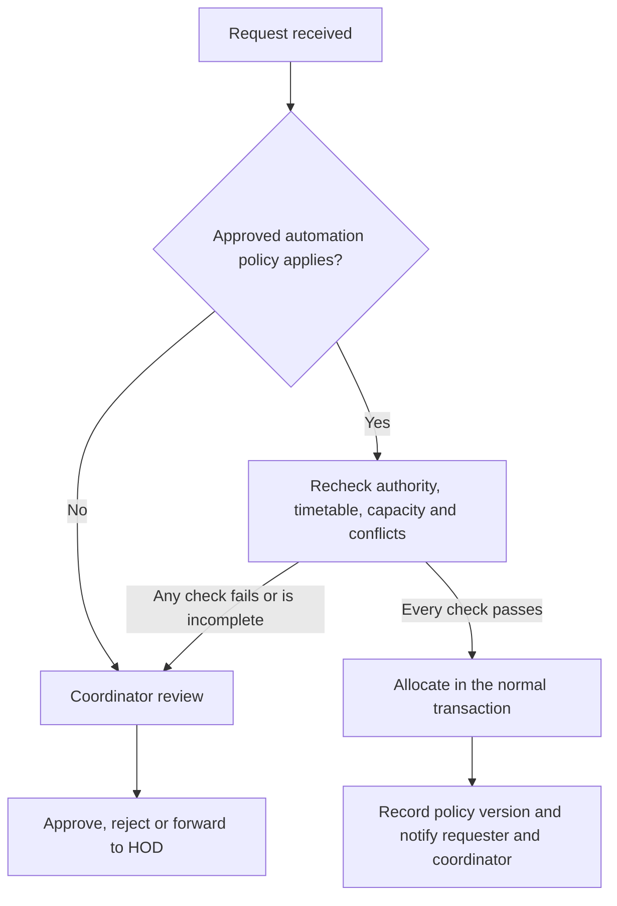

# Approval automation for discussion

This is a proposal for the coordinator and HOD. Requests currently require their normal decision.

A later policy could automatically approve routine faculty extra classes when every required check passes: authorized faculty and room scope, current published timetable, no conflicting class or booking, confirmed capacity, attendance within capacity and permitted whole-hour timings. The policy owner must choose which rooms, reasons and time limits qualify. Student club requests can remain manual unless the university approves a separate policy.

The coordinator should see a queue of exceptions rather than receive a phone alert for every routine request. A digest and escalation reminders could support that queue. Forwarded requests must still wait for the HOD.

Before implementation, agree on policy ownership, qualifying reasons and rooms, advance-notice limits, cancellations, daily limits, exceptional closures and who can suspend automation. Use the same allocation transaction and database overlap constraint; a cached green card must never authorize a booking.
