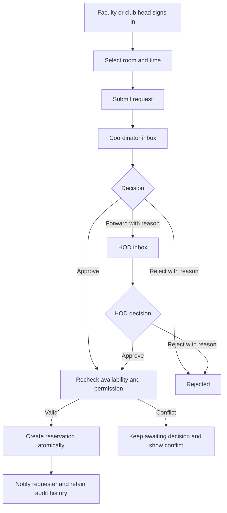
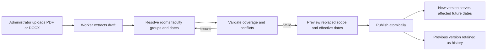
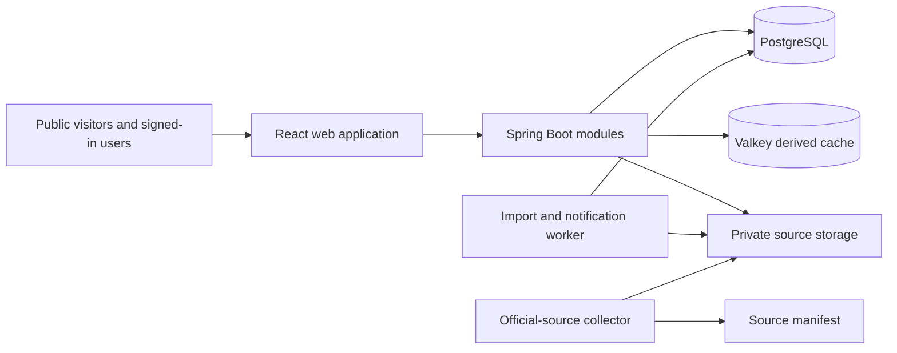

# QuickSlot product and architecture plan

Status: implementation architecture based on user decisions on 20 October 2026. Java and Spring Boot replace the earlier Python stack at the user's request. This document describes intended behavior, not completed functionality.

## Product scope

Start at Graphic Era Hill University, Dehradun. Account for every course using listed rooms, across departments and semesters. The supplied CSE III and V semester timetables are prototype inputs; they do not establish complete campus coverage. Initial student discovery covers classrooms and lecture theatres. Other venues can be registered later under explicit access policies.

Anyone can search public room availability without signing in. Students cannot request bookings. Show: "Based on published schedules. Check the room before using it; an unscheduled class or activity may be taking place." This notice does not replace coverage validation. Unknown data remains Unknown.

Faculty and verified club heads sign in to submit requests. Club heads do not need a sponsor. The responsible CS allocation coordinator approves, rejects, or forwards a request to the HOD. The HOD can approve or reject in the department scope. Administrators manage accounts, room inventory, and timetable imports/publication; administration alone does not grant booking approval. Treat roles as capabilities that can coexist on one account. Deny self-approval; another eligible decision maker must act.

## Booking workflow

Escalation is a routing state, not a reservation. Proposed rule: after forwarding, the HOD owns the decision; the coordinator can inspect it but cannot race to decide it. Confirm this operating policy during prototype review. Record forwarding actor, time, reason, and decision history. Requests do not hold rooms. Approval rechecks current policy and schedule in the database. Failed approval leaves the request awaiting decision with a conflict explanation.



Owners can withdraw undecided requests. Cancellation of confirmed bookings requires an explicit policy; propose owner cancellation before start or scoped approver cancellation with a reason. Cancellation keeps the original decision history and releases occupancy in one transaction. Expiry must cover pending and forwarded requests.

## Timetable lifecycle

Support native PDF adapters and structured DOCX table imports. Scanned documents need a separately reviewed extraction path; unsupported formats fail visibly. Preserve source bytes, URL when applicable, digest, retrieval time, transport verification, page/cell evidence, and adapter version. Deduplicate identical source bytes per scope. A changed filename is not sufficient evidence of a new schedule.

A version has campus, department, programme, semester, section/group, effective dates, and review status. Keep raw candidates separate from verified events. Review elective alternatives, shared classes, teacher aliases, leading-zero room codes, merged periods, and online sessions. Source dates are evidence, not proof that a timetable is currently authoritative.



Replacement retires only the overlapping scope and dates. Preserve unrelated active schedules and historical dates. Block publication that conflicts with confirmed reservations until an authorized person resolves them. Website collection only creates source candidates; it never publishes automatically. Failed downloads retain the previous verified schedule.

## Architecture

Use a modular monolith: one Spring Boot application, with background workers introduced when import workloads require them. PostgreSQL is authoritative. Valkey is optional for performance and never decides booking correctness. Retain React, TypeScript and Vite. Use Docker Compose and Caddy for the first deployment; measure before adding infrastructure.



Modules: identity and permissions; campus inventory and room policy; timetable ingestion and publication; availability; requests and approvals; notifications and audit. Routers validate transport and authorize access; application services own use cases and transaction boundaries; domain functions implement scheduling and policy; persistence modules query storage. No services importing API handlers. No global application mutex as booking protection.

## Data and integrity

Core records: campus, department, user, role assignment, club and verified club-head assignment, room, room alias, room policy, allocation assignment, import/source, draft candidate and issue, timetable scope/version, recurring session, dated event, room occupancy, calendar exception, coverage declaration, request, routing/decision history, booking, audit event, durable session, idempotency command, job and outbox.

All classes, closures and approved bookings participate in the same dated room occupancy constraint. Use half-open intervals so adjacent classes do not conflict. Enforce non-overlap in PostgreSQL, plus sorted resource/day locks and a shared publication guard. Approvals and publication share the writer protocol. Scope authority comes from the authenticated account and server-side assignments.

Read availability from one consistent snapshot across published schedules, bookings, restrictions and coverage. Return Available, Occupied, Restricted or Unknown with a reason and as-of time. A missing timetable for a room-using course prevents verified-free results unless a responsible administrator has established complete coverage for that room/date. Public responses omit requester identities, private event purpose and teacher personal data. Teacher search uses schedules rather than physical tracking; public visibility needs a separate policy decision before release.

Use durable opaque sessions, secure cookies and CSRF protection. Store idempotency and outbox events in PostgreSQL. Cache versioned derived results only; database fallback must work. Keep slow parsing and delivery outside scheduling transactions.

## Intended project structure

```text
apps/web/src/
  app/                  routing, session and application shell
  features/
    availability/
    requests/
    approvals/
    timetable-admin/
    room-admin/
    identity/
  components/           shared accessible UI
  lib/                  API transport and date helpers
  styles/               tokens, typography and global rules
apps/api/src/main/java/in/quickslot/
  modules/
    identity/
    inventory/
    timetables/
    availability/
    requests/
    notifications/
  core/                 configuration, database, security, logging
apps/api/src/main/java/in/quickslot/jobs/
apps/api/src/test/
docs/rework/
scripts/                explicit maintenance and source collection
```

Within a module, add router, schema, service and repository files only when responsibility warrants them. Prefer clear functions to wrapper classes. Extract a shared abstraction only after repeated behavior is understood. Comments explain a non-obvious reason; omit separator banners and comments that repeat code. Use explicit types and consistent naming. Pin verified dependencies during implementation.

## Interface direction

Use Swiss alignment and clear sans-serif hierarchy, white/pale paper surfaces, black text and a restrained college-brand accent derived from inspected brand assets. Hand-drawn campus illustrations belong in the welcome view, guidance and empty states. Keep search results, timetable cells, approval details and forms calm and precise. Avoid decorative gradients, generic metric-card dashboards and fake operational statistics. Show coverage and freshness where they affect decisions. Make keyboard use, mobile layouts and readable status labels part of implementation.

## Delivery phases

1. Reconcile repository behavior against these requirements; inventory official sources and source coverage. Deliver compact gap reports and a traceable source manifest.
2. Implement identity capabilities and scoped coordinator/HOD routing, durable sessions and database migrations. Remove student booking permission on the server. Add explicit prototype configuration for demo accounts.
3. Build PDF/DOCX draft imports, evidence review, coverage declarations and atomic scoped version replacement. Import supplied schedules as unverified drafts first.
4. Build public discovery, role-based request/approval screens and admin review using the agreed design language. Remove OS demonstration screens from primary product navigation.
5. Validate concurrency, permissions, coverage, lifecycle and deployment recovery. Demonstrate with clearly labeled data; prepare the HOD review walkthrough.

Do not claim university readiness based on appearance or a successful build. Release gates include real PostgreSQL concurrency checks, cross-role denial tests, forwarded request races, stale timetable publication, duplicate retries, coverage gaps, adjacent intervals, cancellation, worker retries, cache outage, and backup restoration. Add browser checks for public search, faculty request, coordinator forwarding, HOD decision and admin replacement. Record measured latency and dataset size rather than inventing targets achieved.

## Remaining operational decisions

Account provisioning and club-head verification; HOD and coordinator substitutes; booking horizon and cancellation cutoffs; required request fields; notification channels; authoritative term calendar; source completeness; faculty schedule visibility; hosting ownership and backup retention. Use explicit prototype defaults and settle these with university stakeholders before production.
