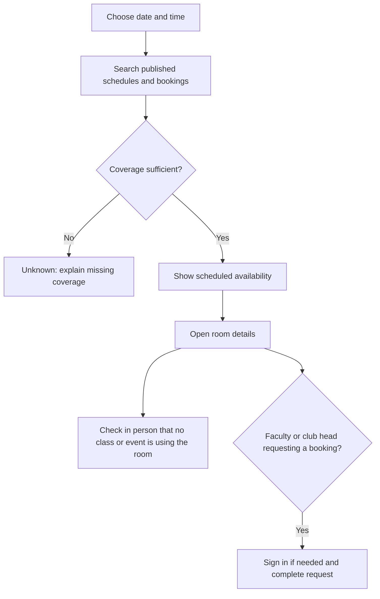
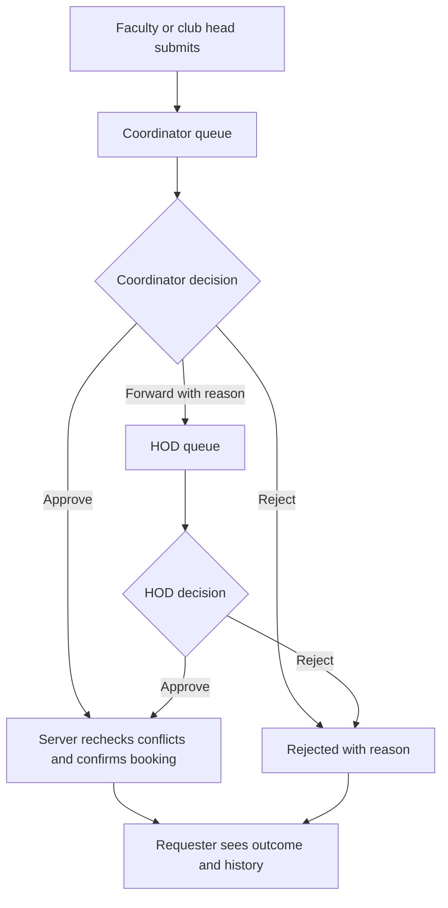
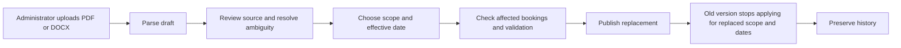

# Frontend review and proposed UI architecture

This report is a source review, not a claim that the current application has been run or verified in a browser. No application code was changed. No AGENTS.md was found in the workspace file inventory. The frontend-design skill was read and applied to this proposal.

## Confirmed scope

Initial campus: Graphic Era Hill University, Dehradun. Public room search covers classrooms and lecture theatres. Students cannot request bookings. Faculty and club heads sign in to submit requests; no club sponsor step is required. The responsible CS allocation faculty approves, rejects, or forwards a request to the HOD. The HOD can approve or reject. Administrators upload, review, and publish timetable replacements. Supplied CSE schedules are prototype source data; they must not imply complete university coverage. Teacher schedule lookup exists in the proposal/current app, but its inclusion and visibility should remain a separate product decision.

## What can be reused

React, TypeScript, Vite, and the existing icon dependency are sufficient foundations. Existing screens cover room search, request submission/history, coordinator inbox, timetable versions, room registers, and audit records. The HTTP wrapper already sends cookie credentials and supports a CSRF token; booking calls accept idempotency keys. These are reusable concepts subject to backend verification.

## Concrete current gaps

| Source | Observation | Required direction |
| --- | --- | --- |
| frontend/src/App.tsx | Navigation uses local activeTab state; no URL routes. Auth failure silently initializes a student demo session. A global demo role switcher exposes administrator selection. | Public browsing needs no session; real login is a separate route. Demo impersonation belongs only in an explicitly enabled demonstration environment. Use URL routes and preserve a booking return path through login. |
| frontend/src/App.tsx | Roles only distinguish STUDENT, FACULTY, ALLOCATION_FACULTY, ADMIN. Student persona is described as a club lead with bookings. | Separate CLUB_HEAD and HOD capabilities. Student stays read-only. Administrator access must not automatically imply approval authority unless explicitly granted. |
| frontend/src/App.tsx | FreeSlotFinder receives no booking-selection callback although it declares one. | Carry room, date, and interval from results to the request form; retain these through login. |
| frontend/src/pages/AllocationInbox.tsx and services/api.ts | Approve/reject exist; no HOD forwarding action or escalation history is exposed. | Add an escalation reason, HOD queue, ownership/status timeline, and authoritative server-returned allowed actions. |
| frontend/src/pages/TimetableAdmin.tsx:141 | File input accepts PDF/JSON/XLSX, not DOCX. | Offer the two agreed authoring formats, PDF and structured DOCX; only claim a format after backend support exists. |
| frontend/src/pages/TimetableAdmin.tsx:95 | Publication uses a browser confirm and does not pass effective dates although the API wrapper supports them. | Review replacement scope, effective date, affected bookings, unresolved mappings, and superseded versions in a deliberate publication screen. |
| frontend/src/pages/TimetableAdmin.tsx:79 | Job polling has no unmount cleanup and permits overlapping async interval requests. | Use one managed query/poller with cancellation, backoff, terminal-state handling, and resume after reload. |
| frontend/src/pages/FreeSlotFinder.tsx and VenueBooking.tsx | Default dates come from UTC toISOString; this can select yesterday in India before 05:30. | Use campus-local dates in Asia/Kolkata, and display that timezone near date/time inputs. |
| frontend/src/pages/VenueBooking.tsx:51 | Request form loads room choices through /admin/venues; defaults include a specific club, purpose, equipment, attendance, and first available room. | Supply a public/requester room endpoint. Blank user-owned fields; intentional room choice or carried search selection. |
| frontend/src/pages/VenueBooking.tsx:96 | A fresh idempotency key is generated for every submission attempt. | Preserve a key for the same logical submission, including network retries; rotate after completion or material form changes. |
| frontend/src/services/api.ts and pages | Extensive any types; request, UI, state, and presentation are mixed in large page files. | Typed feature contracts, small feature components, shared HTTP error handling, and focused hooks. |
| frontend/src/index.css and App.tsx | Dark purple/cyan gradients, glass surfaces, numerous inline styles, and crowded desktop navigation differ from the brief. | Replace with intentional paper/swiss visual tokens and responsive public/staff shells. |
| Multiple pages | Native alert/confirm, generic console-only failures, clickable div menus, and implementation jargon in product copy. | Inline actionable errors; accessible dialogs and menus; plain labels such as Find a room, Requests, Timetables. |
| frontend/package.json | Only dev/build/preview scripts; no frontend testing workflow. | Add focused tests for permissions, login continuation, request status transitions, import review, date boundaries, and keyboard flows. |

The OS & DBMS Lab is prominently exposed in navigation and API helpers. Remove it from the product experience because the user confirmed there is no assessment requirement. Avoid replacing it with invented analytics or unverified active-section statistics.

## Proposed screen inventory

| Route | Audience | Main job |
| --- | --- | --- |
| / | Everyone | Search by date/time, classroom/LT, building and capacity. Default to a useful current interval with visible editable time controls. |
| /rooms/:roomId | Everyone | Room identity/location, selected-day schedule, available interval, coverage evidence and physical-check notice. No requester names or private event details in public responses. |
| /login | Requesters and staff | Authenticate and return to the intended request. Account provisioning method still needs agreement. |
| /requests/new | Faculty, club heads | Confirm room/time, purpose, attendance and optional equipment; review before submitting. |
| /requests | Requesters | Pending, forwarded, approved, rejected, withdrawn and cancelled requests with clear next steps. |
| /requests/:requestId | Requester and authorized reviewers | One status timeline, reasons, room/time, decisions and allowed actions. |
| /approvals | Coordinator and HOD | Scoped queue with filters; open a request to decide or forward. HOD receives escalated requests and can inspect relevant other requests. Exact scope is enforced by the backend. |
| /admin/timetables | Administrator | Import jobs, active schedules, drafts, future replacements and archived versions. |
| /admin/timetables/:versionId/review | Administrator | Compare source and extracted sessions, resolve room/faculty aliases and ambiguous cells, check conflicts, choose effective dates and publication scope. |
| /admin/rooms | Administrator | Buildings, rooms, room types, capacity, study access and closures. |
| /admin/access | Administrator | Accounts, faculty/club role grants and department/room approval assignments. |
| /admin/audit | Authorized staff | Search readable change history; expand structured details when needed. |

Do not add separate dashboards just to display totals. Put queues and work at the first screen for each staff role.

## Workflows





HOD direct approval is also supported; the server controls current ownership and prevents a stale coordinator/HOD screen from recording a second decision. Pending and forwarded requests must never be presented as confirmed reservations.



## Proposed code structure

```text
frontend/src/
  app/                 router, providers, public/staff layouts
  features/
    auth/              session, login, capability checks
    availability/      filters, results, room schedule, coverage presentation
    requests/          form, history, request detail, approval queue and decisions
    timetables/        upload, import progress, source review, versions, publication
    campus/            room/building directory and management
    access/            users, grants and approval assignments
    audit/             readable audit list and details
  shared/
    api/               HTTP transport, generated contracts, typed errors
    ui/                buttons, fields, dialogs, tables, status labels, empty states
    lib/               campus dates, small pure formatters
    styles/            tokens, global rules, layout utilities
  test/                setup and reusable fixtures
```

Each feature owns its route components, API calls, hooks, types and tests. Only extract repeated components with the same meaning. Keep domain rules in the server; UI capability checks explain and hide unavailable actions rather than serving as authorization. Generate API response types from the backend schema where practical. A URL router is justified; a server-query library may be added for cancellation and mutation invalidation, but avoid introducing a global state store before a real need appears. Search filters live in the URL, form state stays local, session is shared, and server data stays in the query layer.

## Visual direction

The subject is a campus room noticeboard: a dependable room timetable with a small amount of student personality. The user explicitly requested paper styling, so off-white is deliberate here. Proposed colors are provisional design choices, not verified GEHU brand tokens.

| Token | Proposed value | Use |
| --- | --- | --- |
| Paper | #F7F7F2 | Page background with very restrained paper texture |
| White | #FFFFFF | Input and schedule surfaces |
| Ink | #202326 | Text and primary rules |
| Campus red | #A52332 | Main action and one restrained emphasis |
| Quiet grey | #62686D | Secondary text |
| Available green | #266245 | Available status with text/icon, never color alone |

Use a self-hosted sans family such as IBM Plex Sans for interface text and its condensed companion for selected display headings. Confirm licensing and final font choice during implementation. Large left-aligned headings and a disciplined grid express Swiss influence; thin schedule rules and modest square-ish control corners keep the product useful. Avoid oversized typography inside operational tables.

One original hand-drawn classroom/door/book illustration on the public landing view provides personality. Use a sketched annotation to point toward the physical-check notice where useful. Keep doodles out of approval tables, source review and timetable cells. No random rotating cards, scattered stars, endlessly moving marquees, fake stamps, or generic marketing claims.

```text
Desktop public search
[QuickSlot / GEHU Dehradun]                 [My requests] [Sign in]
Find a place to study.             small classroom illustration
[Date] [From] [Until] [Room type] [Find rooms]
Timetable coverage notice / prototype evidence
Room             Building       Available until       Status
[Open room]      [location]     [time]                [text + icon]
```

Mobile stacks filters, keeps the date/time summary visible, and uses room rows with clear tap targets rather than shrinking a desktop table. Staff navigation becomes a compact drawer; approval detail puts the room/time and decision context above the actions.

## Copy and evidence rules

Use: "No scheduled class found. Check the room in person before sitting; last-minute changes may not appear here." With incomplete data: "Availability unknown: we do not have all timetables for this room." Show real source scope, effective date and last verified time. Do not claim live occupancy, official university endorsement, or campus-wide coverage from the prototype files. Public room views show schedule labels only as privacy policy permits. Staff audit views can expose the appropriate detail.

## Implementation order and acceptance

1. Confirm backend contracts and role/state model; build routes, public/session separation and shared visual tokens.
2. Deliver one complete flow: public search, room detail, sign-in continuation, faculty/club request, coordinator approval and requester outcome.
3. Add HOD forwarding and decision conflict handling.
4. Deliver PDF/DOCX draft review, effective-date replacement and history.
5. Add administrative directories and audit views, then polish responsiveness and accessibility.

Meaningful verification: students cannot request via UI or API; guest search works without auto-login; room/date selection survives login; forwarded requests appear to HOD; two reviewers cannot both decide; network retry does not duplicate a request; source coverage is never silently overstated; replacement dates do not remove unrelated courses; India date boundaries work; slow search results cannot overwrite newer results; keyboard focus and dialog return work; loading/error/empty states are actionable. Browser review at mobile and desktop sizes is required before calling the UI ready. No application tests were run for this documentation-only report.
