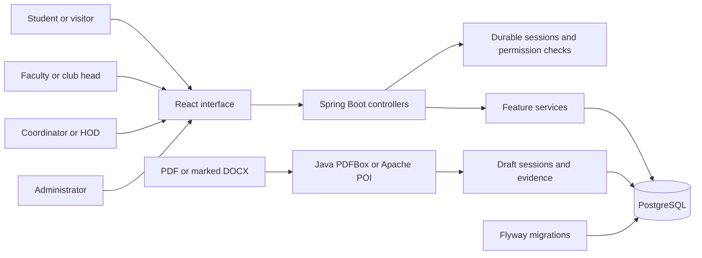
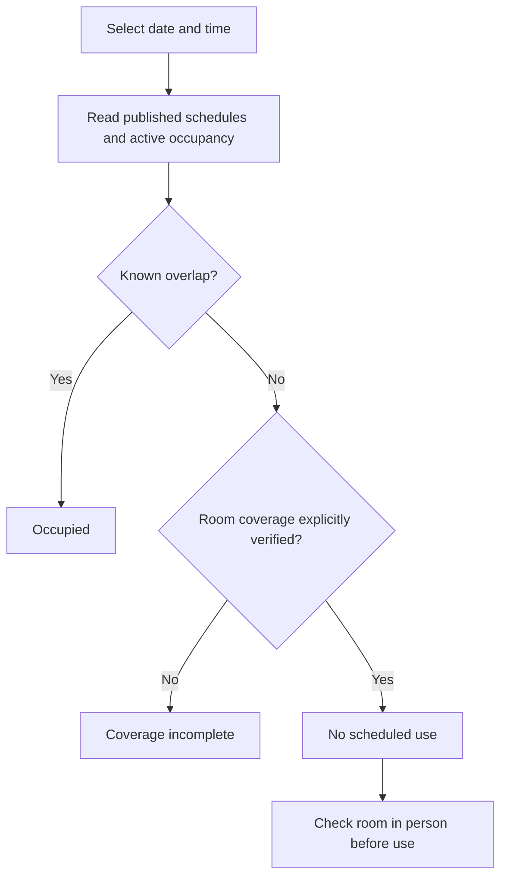
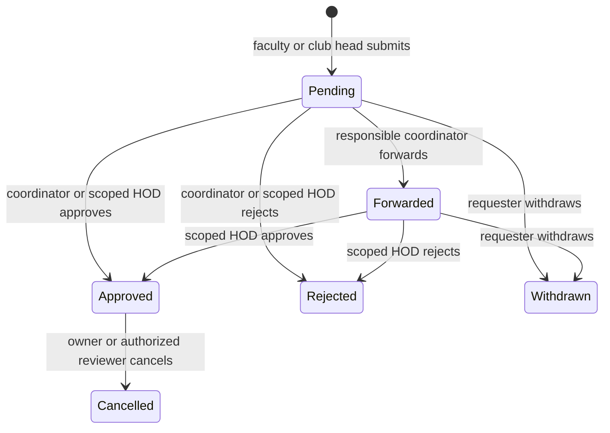
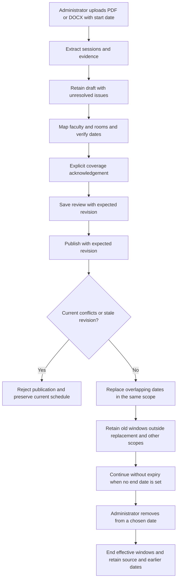
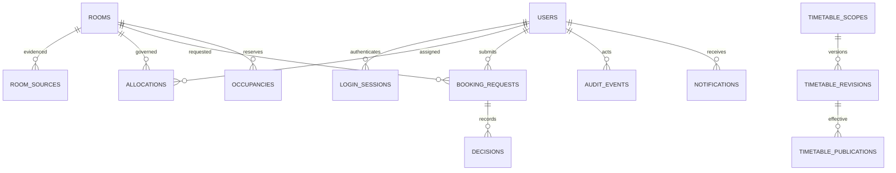
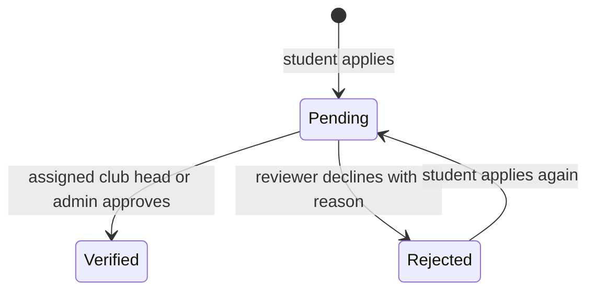

# Implemented system and workflows

The application uses Java 21, Spring Boot 3.5, Spring JDBC, Flyway, PostgreSQL, React and TypeScript. The original Python application is not part of the active implementation.

## System boundaries

Feature packages separate identity, inventory, availability, requests and timetables. Controllers adapt HTTP input, services own transactions and business decisions, and repositories isolate repeated queries. Constructor injection makes the dependencies explicit. The frontend uses typed API transport, shared UI components and focused pages.

## Public discovery

Public search uses one repeatable-read database transaction. It exposes room details and busy intervals without private requester information. The room detail screen shows a seven-day schedule. Faculty lookup requires a staff account (faculty, coordinator, HOD or administrator) and reports scheduled teaching venues, never physical location or guaranteed meeting availability.

## Request and decision

Booking input uses whole-hour boundaries; the interface offers one-hour slots such as 10–11. Timetable classes retain their printed minute timings. Unknown room capacities permit a request but block approval until verified.

Submission does not allocate the room. Approval takes a database transaction advisory lock, locks the request, checks authority and current coverage/conflicts, inserts occupancy and records the decision, notification and audit together. The PostgreSQL exclusion constraint prevents overlapping active booking records. Every timetable publisher follows the same write protocol and checks approved occupancy before replacing a schedule. Self-approval is denied. Forwarding and rejection require reasons.

Idempotency keys distinguish repeated commands from changed input. An owner may withdraw an undecided request. The initial cancellation policy permits the owner or current authorized reviewer to cancel with a reason. Automatic pending-request expiry is not implemented; past requests cannot be approved.

## Timetable import and replacement

PDF extraction reads ruled table geometry and glyph positions. Exact CR/LT labels are matched only to a single active room in the same campus. Unknown or ambiguous labels remain for review; room matching does not confirm complete coverage. Word extraction uses the template's marked tables and explicit IDs. Neither adapter guesses unresolved faculty identities. Administrators can download the original source beside the extracted rows. A supplied Word template is available in the timetable administration screen.

The end date is optional and empty by default. A null end means the timetable continues until an administrator replaces or removes it. Publishing a replacement changes the overlapping dates within that scope; uploading a draft alone does not change availability. Removal ends that revision's effective windows from the administrator's chosen date. Earlier windows, original source bytes and audit events remain available. Both commands use the scheduling write lock and reject stale revision numbers.

Room colors come from the availability response for the selected date and hours: green for confirmed free, red for a class or approved booking, neutral when completeness is unconfirmed. No matching class in a single course PDF is sufficient to mark a room free.

Reviewed classes remain dated publication rules rather than materialized daily occupancy rows. Availability combines those rules with booking occupancy. A shared PostgreSQL write lock makes publication and approval mutually consistent; replacing it with finer resource locks is a future measured optimization. The importer currently performs bounded extraction inside the HTTP request. There is no background worker or external notification service in this milestone.

## Data relationships

Campus room coverage must be confirmed by an administrator after accounting for all courses using the room. The current download inventory covers CSE only and is not published automatically. Operating policies, full source coverage, account provisioning and recovery validation remain release gates documented in the root README.

For the current local demonstration, the user chose the supplied CSE III and V timetables as the availability dataset. The demo profile publishes source-backed classroom/LT occupancy and uses that dataset for green/red results. It includes elective room assignments printed in each page's legend. Faculty identities are optional for room occupancy, so missing faculty does not require an invented name. This initial publication is persisted once; restarting the app must not restore a timetable an administrator removed or replaced. The normal publication and conflict rules continue to govern subsequent changes.

## Provided room inventory

The supplied CSE III and V PDFs both identify 017(CR), 106(LT), 107(CR), 113(CR), 114(CR), 115(CR), 116(CR), 117(CR), 123(CR), 124(LT), 206(LT) and 224(LT). The local seed reads those files rather than inventing rooms. It stores a SHA-256 and the printed label per source. Building and capacity remain unknown. This inventory extraction does not attest complete timetable coverage or publish teaching sessions.

## Club profiles and student verification

Co-Dev profile, officials, mentor and social/contact links come from the supplied Aarambh 4.0 project. Public profiles expose no membership applications. Students sign in to apply. Assigned club heads or same-campus administrators review applications. Verified membership does not give students room booking permission.

A unique club/student constraint and account row lock prevent duplicate join requests. Decisions lock the membership row and write an audit event in the same transaction. Review authority is scoped to the club; an unrelated head cannot view applications or decide them.

## Floors and availability labels

The user confirmed 017 as ground floor, 1xx as first floor and 2xx as second floor. Source inventory records this convention; administrators can correct confirmed room details. Capacity and building remain unconfirmed until entered by an administrator. Metadata updates share the booking write lock.

Green means free against verified schedules and red means a class or booking overlaps. Incomplete schedules retain UNKNOWN internally, with a neutral public card and no verification badge. Missing course schedules never become green simply because one supplied timetable has an empty cell. Guests sign in when requesting a room; timetable completeness and account authentication are separate checks.

Faculty-by-name teaching schedules are absent from public, student and club-head navigation, and the API denies those roles independently of the UI. Room calendars remain public and show generic class/booking intervals rather than requester identities or booking purposes.
